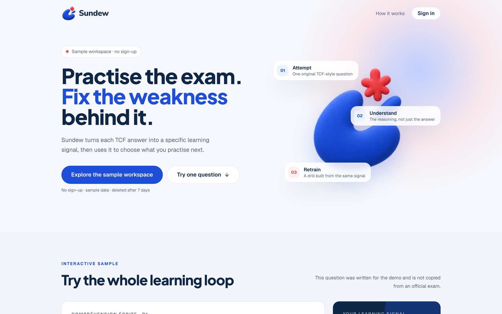
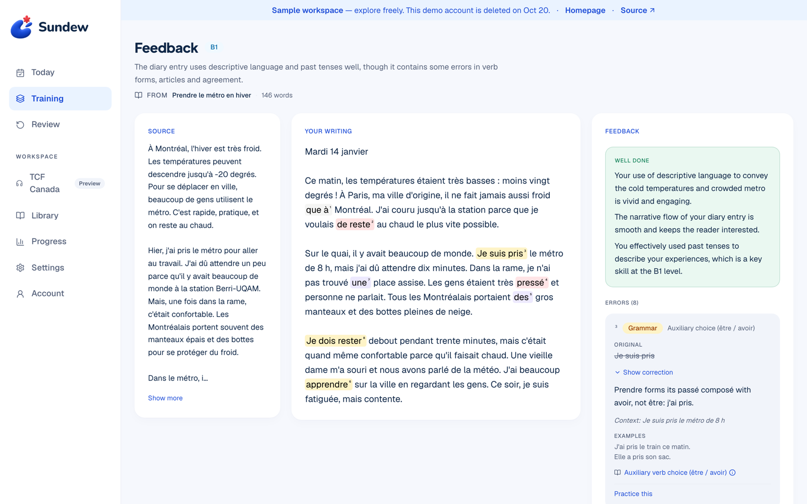
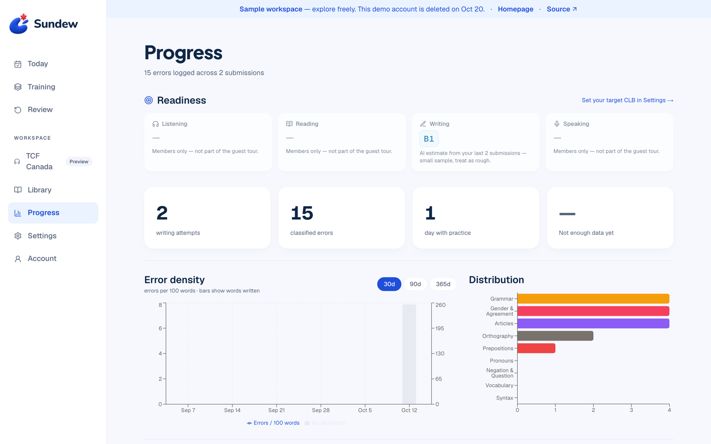

# Sundew

> **Practise the exam. Fix the weakness behind it.**
>
> An output-driven French trainer for TCF Canada: every answer you write becomes a
> classified learning signal that decides what you practise next.

[](https://sundew.jingxuanxu.com)
[](https://github.com/Jingxx32/sundew/actions/workflows/ci.yml)




## Try it in 30 seconds

**[sundew.jingxuanxu.com](https://sundew.jingxuanxu.com) → “Explore the sample workspace”.**
One click, no sign-up. You land in an A2 learner's workspace with real app output:

- **AI writing feedback** — a diary entry with every error highlighted, classified and explained
- **Progress** — how those errors roll up into a learner profile and error-density trends
- **Conjugation drills** — live, auto-graded practice
- **Reader + vocabulary** — click-to-define look-ups and Leitner review

The guest account and its data are deleted after 7 days. TCF exam content, speaking and
other paid-AI features stay with invited members, so a guest never triggers a paid AI call.

## Why it exists

Language sticks when you **produce** it, not when you consume it. Tools like NotebookLM make
French easier to understand — and in doing so remove the friction that drives acquisition.
Sundew keeps that friction and makes it useful:

```
Read French material
        ↓
AI generates a writing task anchored to what you just read
        ↓
You write
        ↓
AI returns structured feedback, every error classified against a fixed taxonomy
        ↓
Errors flow into a persistent learner profile
        ↓
Your weak spots pick the next task, drill or review
```



## Features

| Area | What ships |
|------|------------|
| **Writing loop** | Library + reader with click-to-define, AI writing tasks, structured feedback, errors archive, learner profile |
| **Progress** | Error density over time, distribution by category, per-skill readiness, AI CEFR estimate |
| **TCF Canada** | ~3,200 listening/reading questions, drill + timed exam modes, per-question history, a review queue for missed questions |
| **Practice** | Podcast cloze dictation (Whisper word timestamps), conjugation drills (LEFFF, deterministic grading), vocabulary gaps with Leitner review |
| **Learning home** | Today plan, Training by skill, a source-linked Review list |
| **Speaking** | Read-aloud with Azure pronunciation assessment |
| **Accounts** | Better Auth (Google, email code), invite-only sign-up, one-click guests with a seeded sample workspace |
| 🚧 In development | TCF speaking Task 2 simulation (behind a feature flag) |



## Engineering highlights

- **A taxonomy the AI must obey.** [`ERROR_TAXONOMY`](src/lib/taxonomy.ts) defines 37 error
  types for A2–B1 learners. Feedback is requested as OpenAI structured output validated with
  Zod, so every error lands in a category the dashboards and drills can index.
- **Don't trust LLM offsets.** Model-reported character spans drift and short fragments
  (“des”, “à”) repeat. [`locateErrorSpan`](src/lib/feedback/error-span.ts) re-anchors each
  highlight from the quoted sentence before falling back to the nearest match.
- **Paid AI under a budget.** Every OpenAI call goes through one client that counts against
  a per-member daily limit ([`AI_DAILY_LIMITS`](src/lib/access/limits.ts)); a test lists the
  actions that must check the budget before saving work.
- **Guests that clean up after themselves.** Anonymous accounts get a seeded sample workspace,
  are rate-limited per IP and capped per day, and a Vercel cron deletes them after 7 days.
  Every table with a `user_id` is discovered automatically for deletion, and a test fails if
  a child table is missed.
- **No API layer.** Pages are async server components calling server actions directly;
  route handlers exist only for auth, cron, signed media URLs and uploads.
- **Content boundaries.** Exam material and recordings never enter Git or the public demo;
  demo content is tracked in a [source register](docs/demo-content-sources.md).

## Tech stack

| Layer | Choice |
|-------|--------|
| Framework | Next.js 16 (App Router) + React 19 + TypeScript |
| Styling | Tailwind CSS v4 + semantic design tokens |
| Database | PostgreSQL via postgres.js + Drizzle ORM |
| AI | OpenAI (GPT-4o / 4o-mini, Whisper) with Zod structured outputs; Azure Speech for pronunciation |
| Auth | Better Auth — Google, email one-time codes, anonymous guests, admin roles |
| Hosting | Vercel (Montréal) + Azure PostgreSQL (Canada Central) + Cloudflare R2 (private media) |
| UI | Radix UI primitives, Lucide icons; Geist, Plus Jakarta Sans, Source Serif 4 |

## Quick start

Use the Node.js version pinned in `.nvmrc` (also used by CI) and a separate development
database — never point setup or seed scripts at production data.

```bash
# 1. install
nvm use
npm ci

# 2. copy .env.example to .env and set at least DATABASE_URL, BETTER_AUTH_URL,
#    BETTER_AUTH_SECRET and OPENAI_API_KEY (AZURE_SPEECH_KEY/REGION for speaking),
#    then apply migrations
npm run db:init

# 3. verify the checkout (no database or API keys required)
npm run typecheck
npm run lint
npm test

# 4. run the dev server
npm run dev
```

Open <http://localhost:3000>, start a guest session, or sign in with an email code
(in development the code is printed to the server console). See
[guest access](docs/operations/guest-access.md) for how guests and the sample workspace work.

## Project layout

```
src/
├── app/
│   ├── (main)/          # Sidebar shell: today, training, review, library, progress, …
│   ├── tcf/             # Standalone TCF layout: drill, exam, review
│   ├── api/             # Auth, guest-cleanup cron, signed media URLs, uploads
│   └── page.tsx         # Public landing page with a sample question
├── components/          # Sidebar, lookup popover, ui/ primitives
└── lib/
    ├── db/schema.ts     # Database schema, single source of truth
    ├── actions/         # All DB access (server actions)
    ├── ai/              # OpenAI wrappers: lookup, feedback, tasks, …
    ├── access/          # Guest / full / admin rules and AI limits
    ├── taxonomy.ts      # Error taxonomy
    └── tcf/, vocabulary/, conjugation/, speech/, …

drizzle/                 # Generated migration SQL
scripts/                 # DB init/seed, TCF import and TTS pipeline
docs/                    # Roadmap, product specs, operations notes
```

## License

Copyright © 2026 Jingxuan Xu. All rights reserved. Source is available for portfolio and
recruitment evaluation under [LICENSE](LICENSE); this is not an open-source license.

Third-party dependencies and resources retain their own licenses. Private exam materials,
recordings and personal learning data are excluded from the repository and the public demo;
see the [content source register](docs/demo-content-sources.md).
